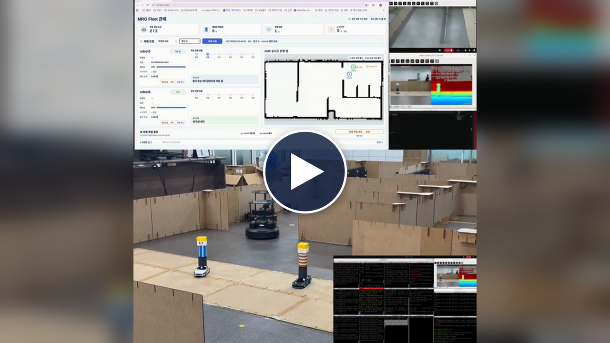
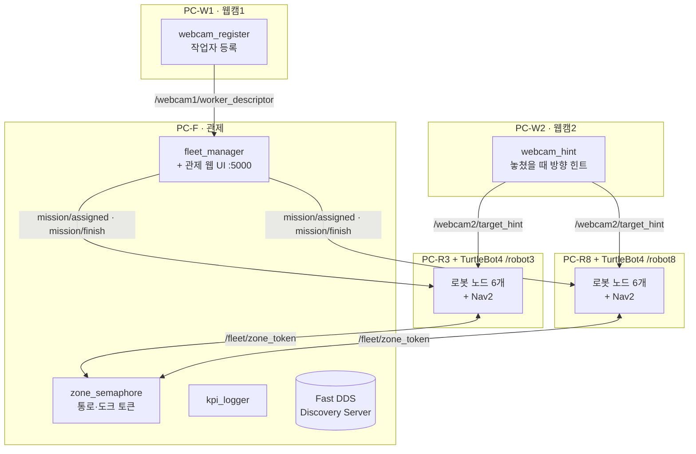
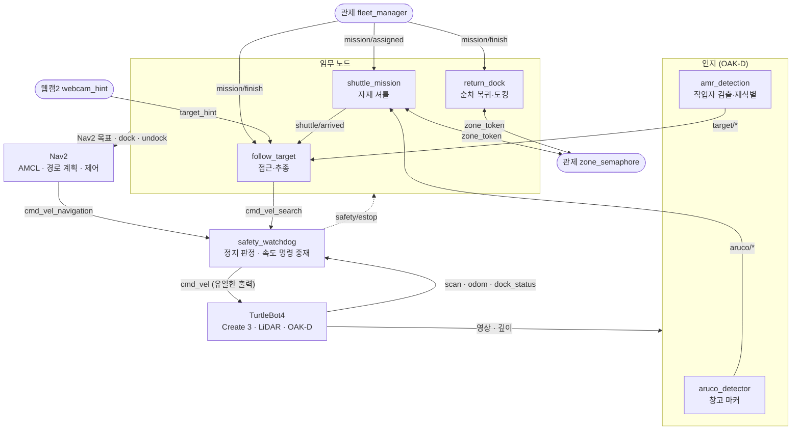

# TurtleBot4 기반 Multi-AMR 작업자 추종 · 정비 지원 시스템

> 정비 작업자가 관제 화면에서 자재를 요청하면 TurtleBot4가 창고에서 자재를 실어 와 작업자를 알아보고 따라다니고,
> 작업이 끝나면 좁은 통로와 도크를 한 대씩 차례로 지나 도크로 돌아오는 2대 Multi-AMR 시스템입니다.
> 실제 TurtleBot4 두 대를 ROS 2 Jazzy · Nav2로 같은 경기장에서 동시에 운용했습니다.

Doosan Robotics ROKEY BOOT CAMP 9기 팀 프로젝트 (2026.08.31 ~ 2026.09.11, 본 단계 8인 통합팀)
· 이 저장소는 팀 원본 [Jik-Kim/mro-multi-amr](https://github.com/Jik-Kim/mro-multi-amr)의 포크입니다.

## 목차

1. [프로젝트 개요](#1-프로젝트-개요)
2. [시연 영상](#2-시연-영상)
3. [정비 지원 시나리오](#3-정비-지원-시나리오)
4. [전체 시스템 구성](#4-전체-시스템-구성)
5. [ROS 2 구조 — 노드와 데이터 흐름](#5-ros-2-구조--노드와-데이터-흐름)
6. [센서 활용](#6-센서-활용)
7. [자율주행 · 도킹 · 두 대 공존](#7-자율주행--도킹--두-대-공존)
8. [실주행에서 생긴 문제와 해결](#8-실주행에서-생긴-문제와-해결)
9. [역할](#9-역할)
10. [결과와 한계](#10-결과와-한계)
11. [기술 스택](#11-기술-스택)
12. [코드 디렉터리 · 빌드 · 실행](#12-코드-디렉터리--빌드--실행)
13. [관련 문서](#13-관련-문서)

---

## 1. 프로젝트 개요

| 항목 | 내용 |
|---|---|
| 주제 | MRO(정비) 현장의 자재 운반 · 작업자 지원 — Multi-AMR 실증 (Phase 1) |
| 기간 | 2026.08.31 ~ 2026.09.11 (미니 단계 4인 조 → 본 단계 8인 통합팀) |
| 로봇 | TurtleBot4 2대 (`/robot3`, `/robot8` 네임스페이스) — Create 3 베이스 · Raspberry Pi · RPLIDAR · OAK-D |
| 작업자 | 스케일 인형을 RC카에 태운 작업자 모형 2명(W1 · W2) |
| 환경 | ROS 2 Jazzy · Nav2 · Ubuntu 24.04 · PC 5대 + 로봇 2대, Fast DDS Discovery Server |
| 요구 · 설계 | BRD v3.6 · SDD v1.0 ([docs/spec/](docs/spec/)) |

**풀려던 문제.** 정비 현장에서 작업자가 자재를 가지러 자리를 비우는 시간을 줄이고, 로봇이 자재를 들고 작업자 곁에 머물게 하는 것이 목표였습니다.
로봇이 두 대가 되면 한 대만 시험할 때 없던 문제가 생깁니다.
- 어느 로봇이 어느 작업자를 맡을지 정해야 합니다.
- 한 대만 지나갈 수 있는 좁은 통로와 도크를 두 대가 함께 써야 합니다.
- 작업자를 잃어버렸을 때 다시 찾아야 합니다.
- 장애물 앞에서는 어떤 명령이 와도 멈춰야 합니다.

**목표와 결과.** 작업자 등록부터 자재 운반 · 작업자 추종 · 순차 복귀 · 도킹까지 한 흐름으로 이어지는 시스템을 실제 로봇 두 대로 시연하는 것이 목표였습니다.
최종 시연에서 한 대는 전 구간을, 다른 한 대는 카메라 고장으로 도크 복귀를 뺀 구간을 수행했습니다([10. 결과와 한계](#10-결과와-한계)).

## 2. 시연 영상

[](https://drive.google.com/file/d/11n-J_89sI_TaFnmyXjEvgcy3bLyjbCYH/view?usp=sharing)

- 위 그림을 누르면 팀 최종 시연 영상(Google Drive)이 열립니다. 로그인하지 않아도 볼 수 있습니다.
- 그림은 시연 영상의 한 장면입니다: 위쪽은 관제 화면(두 로봇 상태 · 실시간 지도), 아래쪽은 경기장에서 작업자 모형 곁에 선 TurtleBot4입니다.

## 3. 정비 지원 시나리오

설계 문서(SDD 3장)의 시나리오 S1~S10을 노드 기준으로 묶은 흐름입니다.

| 단계 | 하는 일 | 담당 노드 |
|---|---|---|
| S1 등록 | 웹캠1이 작업자 특징을 등록하고, 관제가 작업자–로봇을 짝지음 | `webcam_register` → `fleet_manager` |
| S2 준비 | 배정된 로봇이 도크에서 나와(언독) 대기 | `shuttle_mission` |
| S3 요청 | 관제 웹 화면에서 자재 미션을 요청 | 관제 UI → `fleet_manager` |
| S4 자재 셔틀 | 창고 베이로 이동 → ArUco로 위치 확인 → 체류 → 통로(P1) 토큰을 받아 대기공간으로 이동 → `shuttle/arrived` | `shuttle_mission` (+ `aruco_detector`, `zone_semaphore`) |
| S5 합류 | 로봇 카메라로 담당 작업자를 다시 알아보고(재식별 게이트) 접근 | `amr_detection` → `follow_target` |
| S6~S8 추종 | 작업자를 따라감. 놓치면 웹캠2 힌트 방향으로 다시 찾고, 오래 못 찾으면 대기(STANDBY) | `follow_target` (+ `webcam_hint`) |
| 예외 정지 | LiDAR로 가까운 장애물을 보면 모든 주행을 멈춤 | `safety_watchdog` |
| S9 종료 | 관제에서 종료 → 추종 즉시 중단 | `fleet_manager` → `follow_target` |
| S10 순차 복귀 | 도크(DOCK) 토큰 → 통로(P1) 토큰을 한 대씩 받아 도크 앞 접근 지점을 거쳐 도킹(실패 시 재시도) → 토큰 반납 | `return_dock` (+ `zone_semaphore`) |

## 4. 전체 시스템 구성

### 4-1. 배치 — PC 5대 + 로봇 2대



- 모든 PC와 로봇은 관제 PC 한 곳의 Discovery Server를 거쳐 통신합니다(`ROS_DOMAIN_ID=3`).
- 로봇 하나에 로봇 제어 PC 하나가 붙어 로봇 노드와 Nav2를 띄웁니다. 로봇 안의 토픽은 `/robot3`, `/robot8` 네임스페이스로 나뉩니다.

### 4-2. TurtleBot4 두 대의 역할

두 로봇은 같은 코드와 같은 노드 구성으로 동작하고, 맡는 작업자만 다릅니다.

| | robot3 | robot8 |
|---|---|---|
| 담당 | 관제가 짝지은 작업자 한 명 | 관제가 짝지은 다른 작업자 한 명 |
| 하는 일 | 자재 셔틀 → 합류 → 추종 → 순차 복귀 · 도킹 | 같음 |
| 로봇별 설정 | [params/robot3.yaml](ros2_ws/src/mro_bringup/params/robot3.yaml) (네임스페이스 · 도크 자세 등) | [params/robot8.yaml](ros2_ws/src/mro_bringup/params/robot8.yaml) |

두 대가 부딪히는 곳은 좁은 통로(P1)와 도크 구역(DOCK) 두 곳입니다. 이 두 곳은 관제 PC의 `zone_semaphore`가 토큰으로 한 대씩만 들어가게 합니다([7-3](#7-3-두-대-공존--구역-토큰)).

## 5. ROS 2 구조 — 노드와 데이터 흐름

### 5-1. 패키지

| 패키지 | 내용 | 실행 노드 |
|---|---|---|
| [`mro_interfaces`](ros2_ws/src/mro_interfaces) | 메시지 · 서비스 계약 (`Mission`, `WorkerDescriptor`, `TargetHint`, `ZoneToken`, `RequestMission` 등) | — |
| [`mro_perception`](ros2_ws/src/mro_perception) | OAK-D 작업자 검출 · 거리 보정 · 재식별 게이트, ArUco | `amr_detection`, `aruco_detector` |
| [`mro_webcam`](ros2_ws/src/mro_webcam) | 웹캠1 작업자 등록, 웹캠2 방향 힌트, 호모그래피, KPI 로거 | `webcam_register`, `webcam_hint`, `kpi_logger` |
| [`mro_navigation`](ros2_ws/src/mro_navigation) | 자재 셔틀, 작업자 추종, 순차 복귀 · 도킹, 안전 감시 | `shuttle_mission`, `follow_target`, `return_dock`, `safety_watchdog` |
| [`mro_fleet`](ros2_ws/src/mro_fleet) | 작업자–로봇 배정 · 미션 관리 · 관제 웹 UI · DB, 구역 토큰 서버 | `fleet_manager`, `zone_semaphore` |
| [`mro_bringup`](ros2_ws/src/mro_bringup) | PC 역할별 launch, 공통 · 로봇별 · 경기장 파라미터, 지도 | — |

앱 패키지는 `nodes/`(rclpy, 메시지 변환과 호출 순서)와 `core/`(ROS에 의존하지 않는 판단 로직)로 나뉩니다.

### 5-2. 로봇 한 대 안의 데이터 흐름 (`/robotN`)

[robot.launch.py](ros2_ws/src/mro_bringup/launch/robot.launch.py)가 노드 6개를 띄우고, Nav2는 [safety_nav2.launch.py](ros2_ws/src/mro_navigation/launch/safety_nav2.launch.py)로 따로 띄웁니다. 그림의 `aruco/*`는 `aruco/id · distance · pose`, `target/*`는 `target/map_point · visible · paired · worker_id`, `mission/assigned`는 `amr_detection`도 받습니다.



- **속도 명령은 `safety_watchdog` 하나만 로봇에 냅니다.** Nav2의 최종 출력은 `cmd_vel_navigation`으로, 추종 노드의 제자리 회전은 `cmd_vel_search`로 워치독에 들어갑니다. 워치독이 정지 상태 · 도킹 여부를 보고 걸러서 `cmd_vel`로 내보냅니다.
- 각 노드의 상태(`approach/status`, `shuttle/status`, `safety/estop` 등)는 관제와 KPI 로거가 받아 화면 표시와 KPI 산출에 씁니다.

### 5-3. 주요 노드

| 노드 | 입력 | 출력 | 하는 일 |
|---|---|---|---|
| [`shuttle_mission`](ros2_ws/src/mro_navigation/mro_navigation/nodes/shuttle_mission_node.py) | `mission/assigned`, `aruco/*`, `safety/estop` | `shuttle/status`, `shuttle/arrived`, 토큰 요청 | 언독 → 창고 베이 → ArUco 확인 → 체류 → P1 토큰 → 대기공간 |
| [`follow_target`](ros2_ws/src/mro_navigation/mro_navigation/nodes/follow_target_node.py) | `shuttle/arrived`, `target/*`, `/webcam2/target_hint`, `mission/finish`, `safety/estop` | `approach/status`, Nav2 목표, `cmd_vel_search` | 작업자 재식별 확인 → 점진 접근 → 추종 → 놓치면 재탐색 · STANDBY |
| [`return_dock`](ros2_ws/src/mro_navigation/mro_navigation/nodes/return_dock_node.py) | `mission/finish`, `approach/status`, `safety/estop` | `shuttle/status`, 토큰 요청, Nav2 목표 · dock | DOCK → P1 토큰 순서로 받아 접근 지점 경유 도킹, 실패 시 재시도, 토큰 반납 |
| [`safety_watchdog`](ros2_ws/src/mro_navigation/mro_navigation/nodes/safety_watchdog_node.py) | `scan`, `odom`, `dock_status`, `cmd_vel_navigation`, `cmd_vel_search` | `cmd_vel`, `safety/estop`, `safety/state` | LiDAR 전방 거리로 정지 · 해제, 속도 명령 중재, 후진 차단, 도킹 중 명령 보류 |
| [`amr_detection`](ros2_ws/src/mro_perception/mro_perception/nodes/amr_detection_node.py) | OAK-D 영상 · 깊이, `/webcam1/worker_descriptor`, `mission/*` | `target/map_point`, `target/visible`, `target/paired`, `target/distance` 등 | YOLO 작업자 검출 → 거리 보정 → 등록 특징과 비교하는 재식별 게이트 |
| [`aruco_detector`](ros2_ws/src/mro_perception/mro_perception/nodes/aruco_detector_node.py) | OAK-D 영상 | `aruco/id`, `aruco/distance`, `aruco/pose` | 창고 베이 마커 인식 |
| [`fleet_manager`](ros2_ws/src/mro_fleet/mro_fleet/nodes/fleet_manager_node.py) | `/webcam1/worker_descriptor`, 로봇 상태, `/fleet/zone_event` | `/fleet/mission`, `/robotN/mission/assigned`, `/robotN/mission/finish` | 작업자–로봇 배정, 미션 요청 · 종료 처리, 관제 웹 UI · DB |
| [`zone_semaphore`](ros2_ws/src/mro_fleet/mro_fleet/nodes/zone_semaphore_node.py) | `/fleet/zone_token` (서비스) | `/fleet/zone_event` | P1 · DOCK 구역 토큰, 선착순 대기열, 오래 쥔 토큰 회수 |
| `webcam_register` / `webcam_hint` | 웹캠 영상 | `/webcam1/worker_descriptor` / `/webcam2/target_hint` | 작업자 특징 등록 / 작업자가 있는 방향 힌트 |

토픽 · 서비스 계약 전체는 [docs/interfaces.md](docs/interfaces.md)에 있습니다.

## 6. 센서 활용

| 센서 | 어디에 | 쓰는 곳 |
|---|---|---|
| LiDAR (`scan`) | 각 로봇 | Nav2 위치 추정(AMCL) · 장애물 지도, 그리고 `safety_watchdog`의 독립 정지 판정(전방 부채꼴 최소 거리) |
| OAK-D RGB · 깊이 | 각 로봇 | `amr_detection` — YOLO 작업자 검출과 깊이 기반 거리 · 지도 좌표 산출, 재식별 / `aruco_detector` — 창고 베이 마커 위치 확인 |
| 휠 odometry · `dock_status` | Create 3 | 워치독의 정지 확인 · 회전 판단, 도킹 중 판정 보류 |
| 웹캠 2대 | 경기장 위 | 웹캠1: 작업자 특징 등록 / 웹캠2: 호모그래피로 바닥 좌표를 구해 놓친 작업자 방향 힌트 |

안전은 로봇 안(`safety_watchdog` + Nav2 비용 지도)이 맡습니다. 웹캠 · 관제 · 재식별은 작업을 "더 잘 하게" 할 뿐 "부딪히지 않게" 하는 데는 관여하지 않도록 나눴습니다.

## 7. 자율주행 · 도킹 · 두 대 공존

### 7-1. 주행
- 미리 만든 SLAM 지도([maps/](ros2_ws/src/mro_bringup/maps)) 위에서 AMCL로 위치를 추정하고, Nav2로 목표 지점까지 주행합니다.
- 셔틀 · 추종 · 복귀 노드는 `TurtleBot4Navigator`로 Nav2에 목표를 보냅니다.
- 경기장 좌표(창고 베이, 대기공간, 도크 접근 지점, 홀딩 포인트)는 [params/arena.yaml](ros2_ws/src/mro_bringup/params/arena.yaml)에 있습니다.

### 7-2. 작업자 접근과 추종
- 멀리서 잰 작업자 좌표는 오차가 있어, 한 번에 최종 위치로 가지 않습니다. 매번 **남은 거리의 절반 지점**을 새 목표로 잡고, 최종 이격 거리에 닿으면 추종으로 넘어갑니다(`next_standoff = max(follow_standoff_m, gap / 2)`).
- 추종 중 작업자를 놓치면 잠시 기다린 뒤 회전해서 다시 찾습니다. 회전 방향은 웹캠2 힌트 > 마지막으로 본 쪽 > 기본값 순으로 정합니다. 오래 못 찾으면 STANDBY로 바꿔 관제가 알 수 있게 합니다.

### 7-3. 두 대 공존 — 구역 토큰
- 구역은 **P1**(로봇 구역과 중앙 복도 사이의 좁은 통로)과 **DOCK**(도크 구역) 둘뿐입니다. 로봇끼리만 경합하는 곳에만 토큰을 둡니다.
- 로봇은 구역에 들어가기 직전에 토큰을 요청하고 나온 직후 반납합니다. 거절되면 선착순 대기열에 들어가 기다립니다.
- 받았든 못 받았든 반드시 반납합니다. 못 받은 채 끝나면 대기열에 남아 그 구역이 영구히 잠기기 때문입니다([8-5](#8-5-통로-토큰이-반납되지-않아-구역이-잠김-본인)).
- 보유 시간이 너무 길면 `zone_semaphore`가 강제로 회수해 교착을 풉니다.

### 7-4. 도킹
- 복귀할 때는 DOCK 토큰을 먼저, P1 토큰을 그다음에 받습니다. DOCK을 못 받은 로봇은 P1 바깥 홀딩 포인트에서 기다리므로 통로를 막지 않습니다.
- 도크 사이 간격이 좁아 멀리서 도킹을 시작하면 옆 도크로 향할 수 있습니다. 그래서 반드시 자기 도크 정면의 **접근 지점을 거친 뒤** 도킹합니다.
- 도킹이 실패하면 접근 지점으로 돌아가 다시 시도합니다. 후진은 쓰지 않습니다 — Create 3의 범퍼 · 낙하 센서가 앞쪽에만 있기 때문입니다(워치독이 후진 병진 성분을 0으로 깎습니다).

## 8. 실주행에서 생긴 문제와 해결

각 항목은 **문제 → 원인 → 조치 → 확인한 결과** 순서입니다. 수행 주체는 *본인*(이시율) / *주행 파트*(2인 공동) / *팀*으로 표시했습니다.

### 8-1. 로봇이 멈춘 뒤 다시 출발하지 않음 — 원인 좁히기 (*본인*)
- **문제**: 9/10 실주행에서 로봇이 멈춘 뒤 다시 출발하지 않는 정지가 4건 나왔습니다.
- **원인 좁히기**: 안전 감시 노드를 끈 판으로 다시 주행해, 원인이 주행 로직이 아니라 안전 감시 노드의 판정에 있다는 것을 확인했습니다.
- **조치**: 판정 원인을 아래 8-2 ~ 8-4로 나눠 각각 고쳤습니다.
- **확인한 결과**: 아래 수정 4건을 묶은 판으로 같은 날 언독부터 도킹까지 4회 주행했고, PM이 실행을 참관한 뒤 병합했습니다(관련 커밋 [`5cfa2a7`](https://github.com/sskywalker1209-prog/turtlebot4-multi-amr-worker-support/commit/5cfa2a7), #88). 4회 주행은 수정 4건 전체의 결과이고, 한 가지 수정만의 효과로 나눈 기록은 없습니다. 안전 감시 노드의 골격은 PM이 만들었습니다.

### 8-2. 도킹 중 전방이 늘 장애물로 판정돼 언독이 막힘 (*본인*)
- **문제**: 도크에 붙어 있는 로봇이 언독하지 못했습니다. 또 도킹 중에 워치독이 0 속도 명령을 내기 시작하자 로봇이 스스로 도크에서 떨어지는 일이 생겼습니다.
- **원인**: Create 3는 도크에 정면으로 들어가므로 도킹 중에는 도크 자체가 전방 장애물로 잡힙니다. 그리고 Create 3는 도킹 중에도 속도 명령에 반응했습니다.
- **조치**: `dock_status`로 도킹 여부를 받아, 도킹 중에는 전방 장애물 판정을 보류하고 속도 명령을 한 건도 내지 않게 했습니다. 기동 직후 도킹 여부를 아직 모를 때도 명령을 내지 않습니다.
- **확인한 결과**: 8-1의 묶음 판으로 언독 → 주행 → 도킹 주행을 마쳤습니다. 코드: [safety_watchdog_node.py](ros2_ws/src/mro_navigation/mro_navigation/nodes/safety_watchdog_node.py) `hold_cmd_vel`.

### 8-3. LiDAR 결측 빔 하나로 전방 구역 전체를 무효 처리 (*본인*)
- **문제**: 언독하는 순간 워치독이 "유효한 LiDAR 스캔 없음"으로 로봇을 굳혀 버렸습니다(STUCK).
- **원인**: 정상 스캔에서도 반사가 약하거나 너무 가까운 방향의 전방 빔 일부가 0으로 들어옵니다. 그런데 기존 판정은 결측 빔이 하나라도 있으면 전방 구역 전체를 "모름"으로 쳤습니다.
- **조치**: 결측 빔은 버리고 남은 빔으로 최소 거리를 판정하고, 유효 빔이 절반 미만일 때만 센서 이상으로 보도록 바꿨습니다(`MIN_VALID_FRACTION = 0.5`).
- **확인한 결과**: 8-1의 묶음 판에 포함돼 같은 날 주행으로 확인했습니다. 코드: [core/safety.py](ros2_ws/src/mro_navigation/mro_navigation/core/safety.py) `scan_sectors`.

### 8-4. 센서 데이터 판정과 속도 명령 정리 (*주행 파트*)
- **로봇 · PC 시계 불일치**
  - 문제: 스캔 · odom · 속도 명령이 정상으로 오는데도 워치독이 모두 "오래된 데이터"로 버려, 정지가 풀리지 않거나 정지가 아닌데도 로봇이 움직이지 않았습니다. 로그도 남지 않았습니다.
  - 원인: 메시지 헤더 시각(로봇 Create 3 시계)을 PC 시계와 비교해 신선도를 판정했는데, 두 시계가 어긋나 있었습니다.
  - 조치: 헤더 시각 비교를 빼고 PC가 메시지를 **받은 시각**으로만 판정하도록 정리했습니다. 실주행 로그에서 무선 수신 공백을 확인해 스캔 수신 공백 판정 시간도 늘렸습니다([common.yaml](ros2_ws/src/mro_bringup/params/common.yaml) `scan_valid_s`).
- **속도 명령 중재**
  - 문제: Nav2 · 추종 회전 · 안전 정지가 각자 `cmd_vel`을 내 서로 덮어쓸 수 있었습니다.
  - 조치: 워치독을 `cmd_vel`의 유일한 발행자로 바꾸고, Nav2와 추종 회전은 각각 별도 토픽으로 워치독에 넣게 했습니다. 정지 중 명령은 버리고, 후진 병진 성분은 0으로 깎습니다.
- 확인한 결과: 8-1의 묶음 판(#88)에 포함됐습니다.

### 8-5. 통로 토큰이 반납되지 않아 구역이 잠김 (*본인*)
- **문제**: 두 대 동시 배송에서 한 로봇이 P1을 기다리다 포기하면, 다른 로봇이 P1에 영구히 들어가지 못했습니다.
- **원인**: 셔틀 노드가 토큰을 "보유했을 때"만 반납해서, 기다리다 포기한 로봇이 대기열 선두로 남았습니다.
- **조치**: 토큰을 "요청했으면" 결과와 상관없이 반납하도록 고쳤습니다. 복귀 노드는 같은 문제를 이미 같은 방식으로 다루고 있었습니다(#46).
- **확인한 결과**: 100번 거절당한 뒤 포기해도 반납이 나가는지 보는 단위 시험을 넣었고, PM 확인 후 병합했습니다([`cfe3a3c`](https://github.com/sskywalker1209-prog/turtlebot4-multi-amr-worker-support/commit/cfe3a3c), #92).

### 8-6. 작업자 앞에서 제자리를 맴돔 (*본인*)
- **문제**: 9/8 실주행에서 로봇이 작업자 앞에서 멈춘 채 "도착 → 재검출 → 도착"만 반복했습니다.
- **원인**: 두 가지가 겹쳤습니다. 접근 단계 변수가 매번 1단계로 되돌아갔고, 1단계 목표가 이미 Nav2 도착 판정 범위 안에 있어 로봇이 움직이지 않고 "도착"으로 처리됐습니다.
- **조치**: 단계를 세는 방식을 버리고, 매번 **남은 거리의 절반 지점**을 목표로 잡는 규칙 하나로 바꿨습니다([7-2](#7-2-작업자-접근과-추종)). 목표가 항상 판정 범위 밖에 놓여 실제로 다가가고, 횟수를 정하지 않아도 유한 번 안에 추종으로 넘어갑니다. 관제와 주고받는 상태 값은 바꾸지 않았습니다.
- **확인한 결과**: 실주행 상황을 시험으로 재현해 확인했습니다([`45cbfcc`](https://github.com/sskywalker1209-prog/turtlebot4-multi-amr-worker-support/commit/45cbfcc), #49).

### 8-7. 복구 동작 개선
- **작업자를 놓친 뒤 다시 찾는 동작** (*본인*): 9/9 실주행 기록에서 세 가지를 확인하고 고쳤습니다([`5bca0da`](https://github.com/sskywalker1209-prog/turtlebot4-multi-amr-worker-support/commit/5bca0da), #56).
  - 놓친 뒤 첫 회전까지 너무 오래 걸림 → 재탐지 대기 시간을 줄임
  - 회전이 좌우로 왕복해 한 바퀴를 다 훑지 못함 → 한 방향으로 회전 방향을 고정
  - STANDBY 판정에 도달할 수 없던 결함 → 판정 위치와 기준 시각을 바로잡음
  - 보이는데 좌표가 없는 상태는 정해진 시간까지만 추종 중으로 인정하도록 했습니다([`7a317bc`](https://github.com/sskywalker1209-prog/turtlebot4-multi-amr-worker-support/commit/7a317bc), #59).
- **정지 후 스스로 벗어나지 못함** (*주행 파트*): 정지가 걸리면 아무도 로봇을 돌릴 수 없는 문제(I-049)에 대해, 정지 확인 뒤 LiDAR 여유가 큰 쪽으로 제한된 각도만 회전하는 안전 회전 복구(SAFE_ROTATE)를 넣었습니다. **이 회전 복구가 실물에서 효과를 냈는지 확인한 기록은 없습니다.**

### 8-8. 두 대 동시 운용 시 Nav2 기동 중단 · 센서 데이터 끊김 (*팀과 함께*)
- **문제**: 한 대씩은 되던 기능이 두 대를 동시에 띄우자 한 로봇의 Nav2가 기동 도중 중단되고, 스캔이 반복해서 끊겨 정지가 걸렸습니다.
- **원인**: 팀원들과 주행 기록을 함께 분석해 원인을 셋으로 나눴습니다.
  - 기동 순간 디스커버리 통신 부하가 몰림
  - 초기 자세가 위치 추정에 들어가지 않음
  - 무선 구간 부하(카메라 영상 중복 구독, 시각화 등)
- **조치**: 회의를 거쳐 다음을 적용했습니다.
  - 두 로봇의 Nav2를 순차 기동
  - 필요한 노드만 전체 통신 정보를 받도록 제한
  - 시나리오 · 실행 흐름을 단순화
  - 시각화 · 중복 카메라 구독 · 기록을 축소
  - 기동 순서 규칙과 위치 확인 관문은 PM이 정리했습니다(#93, #94). 통신 서버 구성과 전체 설계는 팀 · PM 작업입니다.
- **확인한 결과**: 최종 시연에서 두 대가 같은 경기장에서 각자 임무를 수행했습니다([10](#10-결과와-한계)).

## 9. 역할

### 9-1. 팀
- 미니 단계(4인 조) → 본 단계(8인 통합팀, PM 1명 + 주행 · 인지 · 웹캠 · 관제 파트).
- 노드 골격과 인터페이스 계약은 PM이 만들었고, 각 파트가 자기 노드를 개선 · 확장한 뒤 PR 리뷰를 거쳐 병합했습니다.

### 9-2. 이시율 담당
- **미니 단계**: 4인 조 팀장. 외부 웹캠 YOLO 검출 기반 Vision을 맡았습니다(웹캠으로 대상을 찾아 TurtleBot4가 탐색 · 접근). 미니 단계 코드는 이 저장소에 없습니다.
- **본 단계 — 통합팀 주행 파트(2인 공동)**
  - 작업자 추종 개선: 점진 접근(8-6), 재탐지 · 방향 고정(8-7)
  - 도크 복귀 확장: P1 토큰 · 접근 지점 · 비상 정지 처리([`79e1501`](https://github.com/sskywalker1209-prog/turtlebot4-multi-amr-worker-support/commit/79e1501), #46)
  - 안전 복구 개선: 정지 원인 좁히기(8-1), 도킹 중 판정 보류(8-2), 결측 빔 처리(8-3)
  - 구역 사용권(토큰) 반납 결함 수정(8-5)
  - 셔틀–추종 통합 시험, 실주행 시험
  - SLAM 지도 생성, Raspberry Pi · SSH 로봇 접속
  - AMR(주행) 파트 발표

### 9-3. 다른 팀원 담당
| 영역 | 담당 |
|---|---|
| 저장소 골격 · 인터페이스 계약 · 설계 문서 · 리뷰 · 병합, bringup · 기동 순서 규칙 | PM ([Jik-Kim](https://github.com/Jik-Kim)) |
| 안전 감시 노드 골격 | PM |
| 자재 셔틀 미션, 경기장 좌표 실측 | 주행 파트 팀원 |
| 작업자 검출 · 재식별(YOLO, OAK-D), ArUco | 인지 파트(2인) |
| 웹캠 작업자 등록 · 방향 힌트 · 호모그래피 · KPI 로거 | 웹캠 파트(2인) |
| 미션 관리 · 관제 웹 UI · DB | 관제 파트 |
| Discovery Server 구성 | 팀 · PM |

### 9-4. 함께 해결
- 두 대 동시 운용 문제(8-8)는 팀원들과 주행 기록을 함께 분석해 원인을 나누고, 회의를 거쳐 조치를 정했습니다.
- 로봇 · PC 시계 불일치와 속도 명령 중재(8-4)는 주행 파트 작업입니다.

## 10. 결과와 한계

**결과**
- 9/10 실주행에서 한 대로 관제 미션 → 언독 → 창고 베이 → 대기공간 → 추종 → 관제 복귀 지시 → 도킹까지 이어지는 단독 완주를 확인했습니다(팀 기록).
- 최종 시연(9/11)에서 **한 대는 전 구간, 다른 한 대는 카메라 고장으로 도크 복귀를 뺀 구간**을 수행했습니다.

**한계와 남은 과제**
- 안전 회전 복구(SAFE_ROTATE)는 코드에 있지만 실물에서 효과를 확인한 기록은 없습니다.
- 안전 복구 판(#88)을 병합하면서 셔틀의 베이 정밀 정렬 일부가 빠졌습니다. 완주를 위해 정밀도를 내준 교환이었고, 복원은 다음 과제로 남았습니다.
- 제자리 회전이 명령보다 더 도는 문제(odom 지연, [I-051](docs/issues.md))는 열린 상태입니다.
- STANDBY에서 작업자 동선을 비켜 물러나는 동작은 좌표로 옮기지 못했습니다. 지금은 제자리에서 시야만 유지합니다.
- 진행 중 이슈 전체는 [docs/issues.md](docs/issues.md), 파일 단위 작업은 [docs/todo.md](docs/todo.md)에 있습니다.

## 11. 기술 스택

| 분류 | 사용 기술 |
|---|---|
| 로봇 | TurtleBot4 2대 (Create 3 · Raspberry Pi · RPLIDAR · OAK-D) |
| 미들웨어 | ROS 2 Jazzy — Topic · Service · Action, 네임스페이스 분리, Fast DDS Discovery Server(팀 구성) |
| 주행 | Nav2 (AMCL · 경로 계획 · 제어 · 도킹), SLAM 지도, TF2, `turtlebot4_navigation` |
| 인지 | YOLO 작업자 검출 · 재식별, OpenCV, ArUco, 웹캠 호모그래피 |
| 관제 | rclpy 노드 + 웹 UI(Flask), DB |
| 개발 · 시험 | Python, pytest 단위 시험, rosbag2 주행 기록, Git · GitHub PR 리뷰 |

## 12. 코드 디렉터리 · 빌드 · 실행

```text
ros2_ws/src/
├── mro_interfaces/   # msg/srv 계약
├── mro_perception/   # OAK-D 검출 · 거리 보정 · 재식별 게이트, ArUco
├── mro_webcam/       # 웹캠1 등록, 웹캠2 힌트, 호모그래피, KPI 로거
├── mro_navigation/   # 셔틀, 추종 · 재탐지 · STANDBY, safety_watchdog, 복귀
│   ├── mro_navigation/nodes/   # ROS 노드
│   ├── mro_navigation/core/    # ROS 비의존 판단 로직 (safety.py)
│   └── launch/                 # safety_nav2 · 시험용 리그
├── mro_fleet/        # fleet_manager, 관제 UI, DB, zone_semaphore
└── mro_bringup/      # PC 역할별 launch, params(common · robotN · arena · fleet), maps
tools/                # 사전 점검 · 환경 스크립트, KPI 리포트, 진단 도구, 플로차트 생성기
docs/                 # 요구 · 설계 · 계약 · 절차 · 이슈 문서, 다이어그램
```

**빌드** — 클론만으로는 돌지 않습니다. TurtleBot4 패키지 워크스페이스, Discovery Server 설정, Python 가상환경, 몇 가지 apt 패키지를 PC마다 한 번 준비해야 합니다([docs/setup.md](docs/setup.md)).

```bash
cd ros2_ws && colcon build --symlink-install && source install/setup.bash
```

**실행** — 명령과 순서의 정본은 [docs/demo_run_procedure.md](docs/demo_run_procedure.md)입니다. 로봇 제어 PC마다 터미널을 순서대로 띄우고, 그 사이에 위치 확인 관문과 두 대 운용 규칙(기동 순서 등)이 있습니다.

| PC | 역할 | 띄우는 것 |
|---|---|---|
| PC-R3 / PC-R8 (로봇당 1대) | 로봇 제어 | localization · 셔틀 리그 · 셔틀/복귀 노드 · Nav2 · 추종 리그 — 절차서 T0~T14 |
| PC-W1 / PC-W2 | 웹캠 | `webcam1_pc.launch.py` / `webcam2_pc.launch.py` |
| PC-F | 관제 | Discovery Server → `fleet_pc.launch.py` → http://localhost:5000 |

## 13. 관련 문서

- 원본 README(포크 전 팀 저장소 마지막 판): [README.md @ 6a00558](https://github.com/sskywalker1209-prog/turtlebot4-multi-amr-worker-support/blob/6a00558ee97d0fd2a921c69bc7eedbf182cad4da/README.md)
- 요구사항 [BRD](docs/spec/MRO_Multi-AMR_BRD_v3.5.md)(문서 안 버전 v3.6) · 설계 [SDD v1.0](docs/spec/MRO_Multi-AMR_SDD_v1.0.md)
- [docs/architecture.md](docs/architecture.md) 배치 · 데이터 흐름 · [docs/interfaces.md](docs/interfaces.md) 토픽 · 서비스 계약 · [docs/SOT.md](docs/SOT.md) 확정 결정
- [docs/demo_run_procedure.md](docs/demo_run_procedure.md) 실행 절차 · [docs/setup.md](docs/setup.md) 환경 구축
- [docs/issues.md](docs/issues.md) 이슈 기록 · [docs/diagrams/](docs/diagrams) 노드 · 인터페이스 흐름도, rqt_graph
- [PROJECT.md](PROJECT.md) 개요 · 역할(원본)
